<!-- MIMIC 2D | Beura Labs -->

  

  
   
  
  
  

# MIMIC 2D
**Sneak. Hide. Snack.** A playful stealth game where you become household objects, fool suspicious inspectors, and grab every cookie before time runs out.

  

### The mission
- **5 themed houses · 30 stars · 6 colour styles** to unlock.
- Mimic nearby objects, fit the room, and freeze when you're being watched.
- Outsmart inspectors, cameras, lasers and creaky floors.
- Find power-ups, hide, sneak, and collect cookies before time is up.

### Controls
| Action | Controls |
|---|---|
| Move | WASD / arrow keys / touch controls |
| Mimic or interact | E / on-screen **MIMIC** |
| Run | Shift / on-screen **RUN** |

### Run it
Open `index.html` in a modern browser. No build step, install, account, or backend required. Progress stays in your browser's local storage; Google Fonts is an optional external font load with system fallbacks.

**Made by Satyajit Beura · Beura Labs**  
Reuse is permitted only with visible attribution. See the [MIMIC 2D Attribution License](LICENSE).
